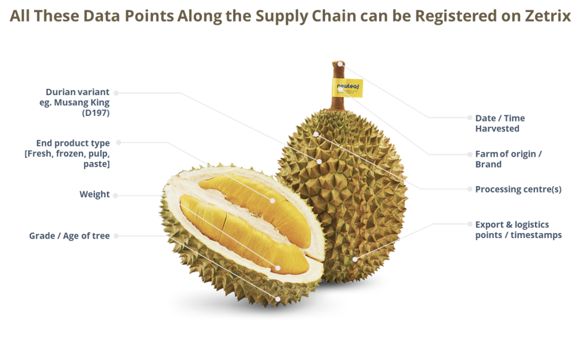

# Consumer Products & Foodstuffs

Premium foods such as birds' nest, fine wine, wagyu-graded beef, craft beer, or designer fruits, are marketed based on their provenance, cultivar or vintage, which makes traceability useful especially for export purposes. Blockchain’s immutability and trustless-ness allows consumers to verify data in the blockchain without relying on other actors in the supply chain or credibility brand marks. More importantly for the producer, this helps to justify the higher price paid by consumers for the Musang King durian, Harumanis mango, Hokkaido melon and so on.

Foodstuffs are also sensitive to storage conditions. Let us take the durian as an example. If durians are not chilled properly, it will rot and go bad really quickly. Malaysia exports $34 million as of 2021 worth of durians and China is one of the largest importers of Malaysian durian. It takes a week or two for durians to reach their destination, thereby posing a challenge in terms of storage conditions.

<figure><figcaption></figcaption></figure>

IoT devices are used to track the environmental conditions of the durian, and anti-tamper seals protect the fruits from counterfeiting attempts. A record for the durian will be created on the blockchain containing data such as weight, species, farm location, photo snapshot, etc. And at every stage of the supply chain, the data collected by the devices will be uploaded to the blockchain.

The data obtained from the tracking help businesses to identify weaknesses in their supply chain and fix them. Since the data is publicly available, consumers can also verify the data independently. The consumer can cross check the information to confirm whether they received the correct durian shipment and if there are any signs of damage on the fruit itself.
