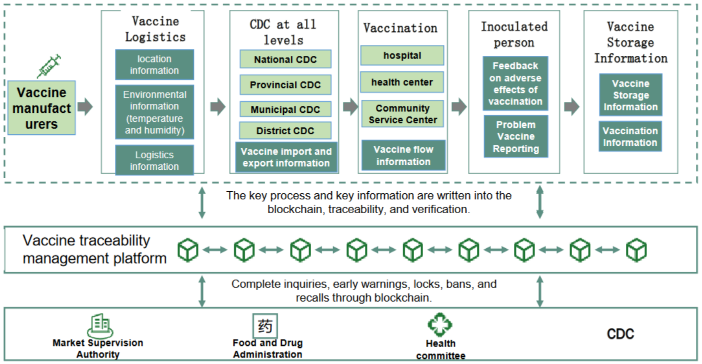

# Vaccines & Pharmaceuticals

As we have realised in the past 2 years, the supply chain is a critical factor in distributing the vaccines to the public in order to reduce the effect of the pandemic globally and to get the economy back on its feet. A vaccine traceability system built on Zetrix could be a viable solution to some of these problems.

Vaccines have specific expiry dates and are extremely sensitive to temperature fluctuations. Using a blockchain based vaccine traceability system enables the vaccine receiver to verify the origin and the storage condition of the vaccine.

Feedback from vaccinated individuals can also be recorded, subject to privacy regulations, if any at all. This layer of transparency and immutability reduces the spread of unsubstantiated or exaggerated claims about the vaccines from being circulated.

Stakeholders in and out of the supply chain can monitor the data being collected about the vaccines. With these data in hand, they will be able to make more informed decisions relating to the deployment of the vaccines. Blockchain traceability can drastically improve the efficiency of administration of the vaccine by the stakeholders, reducing the cases of undersupply and oversupply in different geographical locations.

<figure><figcaption></figcaption></figure>
